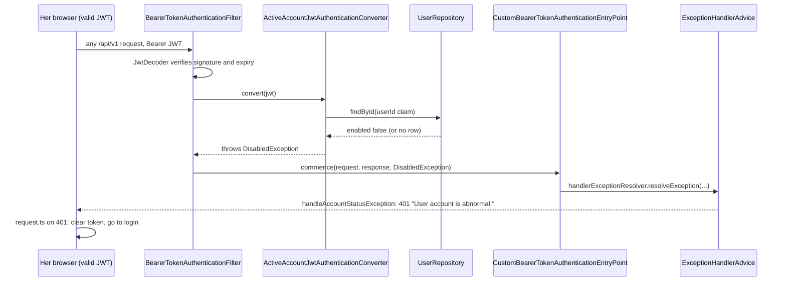

# Students (STU) Design

> Realizes: UC-STU-deactivate-student, FR-SEC-active-account
> Depends on: BR-student-lifecycle, BR-evaluatee-active, BR-evaluation-editable-until-close, BR-submission-owed, BR-section-scoped-access, BR-role-based-access
> See: [use cases](../requirements/use-cases.md#student), [SRS security requirements](../requirements/software-requirements-specification.md#security-and-authorization-requirements), [architectural-design.md](architectural-design.md#security--compliance) (Crosscutting Concepts: authentication, authorization)
> Designed against `main` at `59f0267` (2026-11-06).

## Overview

This area manages a student's account in a course section. Its first designed use case, UC-STU-deactivate-student, replaces the Status switch in the student edit dialog with a dedicated deactivate action. The action has its own route and authority rule, a warning that states the consequences, and a confirmation. It touches three slices of the REST API container: `student` (the action), `security` (who may call it, and refusing a deactivated account on every request), and `evaluation` (BR-evaluatee-active). Team membership is untouched (BR-student-lifecycle).

Before this design, deactivation was a field of the generic `PUT /students/{studentId}`. That route's rule admitted the student herself and refused a course admin not assigned to her course section. Nothing warned the instructor. A deactivated student's JWT kept working for up to two hours, because `MyUserPrincipal.isEnabled()` was checked only at login. And `EvaluationService` still accepted evaluations of her.

## Components & classes

```mermaid
classDiagram
  direction LR
  class StudentController {
    <<reused, student>>
    +deactivateStudent(studentId) Result NEW
  }
  class StudentService {
    <<reused, student>>
    +deactivateStudent(studentId) Student NEW
    +updateStudent(studentId, update) Student CHANGED
  }
  class StudentSecurityService {
    <<reused, student>>
    +isCurrentUserInstructorOfStudentSection(studentId) boolean
    +isCurrentUserAdminOfStudentCourse(studentId) boolean NEW
  }
  class StudentAlreadyDeactivatedException {
    <<new, student>>
  }
  class StudentInstructorAuthorizationManager {
    <<reused, scope widened>>
  }
  class StudentCourseOwnershipAuthorizationManager {
    <<new, security>>
  }
  class ActiveAccountJwtAuthenticationConverter {
    <<new, security>>
    +convert(jwt) AbstractAuthenticationToken
  }
  class SecurityConfiguration {
    <<changed, security>>
    route rule for PATCH deactivation
    GET /students/{studentId} rule widened
    jwt.jwtAuthenticationConverter(...)
  }
  class ExceptionHandlerAdvice {
    <<changed, system>>
    +handleStudentAlreadyDeactivated() 409
  }
  class EvaluationService {
    <<reused, evaluation>>
    +addPeerEvaluation() CHANGED
    +updatePeerEvaluation() CHANGED
    +generateWeeklyPeerEvaluationReportForSection() CHANGED
  }
  class UserRepository {
    <<reused, user>>
  }
  StudentController --> StudentService
  StudentService ..> StudentAlreadyDeactivatedException : throws (6a)
  ExceptionHandlerAdvice ..> StudentAlreadyDeactivatedException : maps
  SecurityConfiguration --> StudentInstructorAuthorizationManager
  SecurityConfiguration --> StudentCourseOwnershipAuthorizationManager
  SecurityConfiguration --> ActiveAccountJwtAuthenticationConverter
  StudentInstructorAuthorizationManager --> StudentSecurityService
  StudentCourseOwnershipAuthorizationManager --> StudentSecurityService
  ActiveAccountJwtAuthenticationConverter --> UserRepository
```

**Backend**
- [`student/StudentController`](../../backend/src/main/java/team/projectpulse/student/StudentController.java), [`StudentService`](../../backend/src/main/java/team/projectpulse/student/StudentService.java), [`StudentSecurityService`](../../backend/src/main/java/team/projectpulse/student/StudentSecurityService.java): one new method each.
- `student/StudentAlreadyDeactivatedException`: new, a `RuntimeException`. Its handler returns HTTP `409` with `Result` code `StatusCode.CONFLICT`; the constant already exists.
- [`system/exception/ExceptionHandlerAdvice`](../../backend/src/main/java/team/projectpulse/system/exception/ExceptionHandlerAdvice.java): maps that exception to `409 CONFLICT`.
- `security/authorizationmanagers/StudentCourseOwnershipAuthorizationManager`: new. It mirrors [`SectionOwnershipAuthorizationManager`](../../backend/src/main/java/team/projectpulse/security/authorizationmanagers/SectionOwnershipAuthorizationManager.java), resolving the course through the student's course section.
- [`StudentInstructorAuthorizationManager`](../../backend/src/main/java/team/projectpulse/security/authorizationmanagers/StudentInstructorAuthorizationManager.java): reused, with its scope widened. It guarded reading a student's evaluation details and now also guards this write route. Its Javadoc is updated to say so; the check is unchanged.
- `security/ActiveAccountJwtAuthenticationConverter`: new.
  - It wraps the existing `JwtAuthenticationConverter` bean, injected by type, so authorities are unchanged. It is a `Converter<Jwt, AbstractAuthenticationToken>`, not a second `JwtAuthenticationConverter` bean, so nothing else autowires it by accident.
  - It reads the `userId` claim the way `UserUtils.getUserId` does (Integer, Long, or String), then loads the user through `UserRepository`. `enabled` lives on `PeerEvaluationUser`, which both `Student` and `Instructor` extend.
  - It throws `DisabledException` when the user is disabled or no longer exists.
- [`security/SecurityConfiguration`](../../backend/src/main/java/team/projectpulse/security/SecurityConfiguration.java):
  - The new route rule goes next to the other `/students/{studentId}` rules, before `denyAll()`. No broader `/students/**` matcher precedes them.
  - The existing `GET /students/{studentId}` rule widens from `userOwnershipAuthorizationManager` to `anyOf(userOwnershipAuthorizationManager, studentCourseOwnershipAuthorizationManager)` (see *Course admin reach*).
  - The converter is set **explicitly**: `.jwt(jwt -> jwt.jwtAuthenticationConverter(activeAccountConverter))`. Today `.jwt(Customizer.withDefaults())` picks up the `JwtAuthenticationConverter` bean implicitly, and it would not pick up a converter of another type.
  - The converter is injected as a parameter of `securityFilterChain(...)`, not through the constructor: it depends on the `JwtAuthenticationConverter` bean that `SecurityConfiguration` itself defines, so constructor injection would be a circular dependency.
- [`evaluation/EvaluationService`](../../backend/src/main/java/team/projectpulse/evaluation/EvaluationService.java): three changes; see *Evaluations of a deactivated student*.

**Frontend**
- [`apis/student/index.ts`](../../frontend/src/apis/student/index.ts): new `deactivateStudent(studentId)`.
- [`pages/students/EditStudentForm.vue`](../../frontend/src/pages/students/EditStudentForm.vue), the dialog that realizes UC-STU-view-student (step 2):
  - **Active student:** a read-only "Active" tag and a **Deactivate** button. The Status switch is not shown.
  - **Deactivated student:** no Deactivate button (3a); the Status switch stays, as the only way to reactivate until UC-STU-reactivate-student is designed.
  - The button opens `ElMessageBox.confirm` with the step-4 wording under *UI text*.
  - **On a refusal**, `request.ts` already shows the server's message as a toast for every error except a `401`, and rejects the promise. So the component shows **no second message**: it catches the rejection and, on `409` (6a), reloads the student with `findStudentById` so the button disappears. A `403` is already routed to the forbidden page by `request.ts`.
- [`pages/students/Students.vue`](../../frontend/src/pages/students/Students.vue): reloads the list every time the dialog closes, as cheap as tracking whether anything changed.
- [`pages/evaluations/SubmitTeamsEvaluations.vue`](../../frontend/src/pages/evaluations/SubmitTeamsEvaluations.vue): both branches of `prepareStartingPeerEvaluations` change.
  - **First submission** (nothing saved this week): the form is built from `findStudentsByTeamId`, and a teammate with `enabled: false` is left out.
  - **Edit** (evaluations already saved): the form loads the saved `PeerEvaluationDto`s, which carry no `enabled` field.
    - It finds the deactivated teammate by matching each `evaluateeId` against the teammate list that `loadStudents` already loaded (`StudentDto.enabled`).
    - An evaluation of a deactivated teammate is shown read-only, greyed out, with a "deactivated" tag, so the evaluator still sees what she wrote.
    - `updatePeerEvaluations` sends `PUT`s only for evaluations of active teammates. This is not a courtesy. Without it, the `400` for the deactivated teammate rejects `Promise.all`, `isLoading` stays on, and the student sees a failure although her other edits were saved.

## Sequence

### UC-STU-deactivate-student: the deactivate action

```mermaid
sequenceDiagram
  actor I as Instructor / course admin
  participant F as EditStudentForm.vue
  participant SEC as Spring Security
  participant C as StudentController
  participant S as StudentService
  I->>F: open the student (steps 1–2, findStudentById)
  I->>F: Deactivate (step 3; not shown for a disabled student, 3a)
  F->>I: warning listing the consequences, asks to confirm (step 4)
  alt cancel (5a)
    I->>F: Cancel: no request; dialog stays on the student
  else confirm (step 5)
    F->>SEC: PATCH /api/v1/students/{studentId}/deactivation
    SEC->>SEC: active-account check, then anyOf(instructor of her course section, course admin of her course), else 403 (6b, 6c)
    SEC->>C: deactivateStudent(studentId)
    C->>S: deactivateStudent(studentId)
    alt already disabled (6a, e.g. another instructor deactivated her first)
      S-->>C: StudentAlreadyDeactivatedException
      C-->>F: 409 "This student is already deactivated."
      F->>I: shows the server's message
      F->>F: reloads the student (findStudentById); Deactivate no longer shown (3a)
    else active
      S->>S: setEnabled(false), save
      C-->>F: 200 StudentDto (enabled false)
      F->>I: "student deactivated" message (step 6); dialog closes; Students.vue reloads the list
    end
  end
```

### FR-SEC-active-account: her existing session



## API contract

| Endpoint or job | Caller (who may) | Request | Success | Errors, by extension |
|---|---|---|---|---|
| `PATCH /api/v1/students/{studentId}/deactivation` (new) | An instructor assigned to the student's course section, or the course admin of her course (BR-student-lifecycle): `AuthorizationManagers.anyOf(studentInstructorAuthorizationManager, studentCourseOwnershipAuthorizationManager)`, before the `denyAll()` catch-all | No body | `200`, `Result` carrying the updated `StudentDto` (`enabled: false`) | 6a: `409 CONFLICT`, "This student is already deactivated." 6b (an instructor of another course section, a course admin of another course, any student including herself): `403`. 6c (no such student): `403`, with a body identical to 6b's, because the check fails closed |
| `GET /api/v1/students/{studentId}` (changed rule) | As today (the student herself, or an instructor assigned to her course section), **and** the course admin of her course: `anyOf(userOwnershipAuthorizationManager, studentCourseOwnershipAuthorizationManager)` | Unchanged | Unchanged | Anyone else: `403`, as today |
| `PUT /api/v1/students/{studentId}` (changed) | Unchanged | Unchanged. Every caller keeps sending the student's current `enabled` | Unchanged | Instructor branch of `updateStudent` only: `enabled` true to false is refused with `IllegalArgumentException`, which `ExceptionHandlerAdvice` already maps to `400` `INVALID_ARGUMENT`, message "Use the deactivate action to deactivate a student." |
| Every authenticated `/api/v1/**` request (changed) | Unchanged | Bearer JWT | Unchanged | Account disabled or deleted: `401` (FR-SEC-active-account) |
| `POST /api/v1/evaluations`, `PUT /api/v1/evaluations/{evaluationId}` (changed) | Unchanged | Unchanged | Unchanged | Evaluatee deactivated: `400` `INVALID_ARGUMENT`, naming the condition (BR-evaluatee-active) |

## Key decisions

**A dedicated route.**
- Chosen: `PATCH /students/{studentId}/deactivation` with its own rule.
- Rejected: reusing `PUT /students/{studentId}`. Its rule (`UserOwnershipAuthorizationManager`) admits the student herself and refuses a course admin not assigned to her course section, both wrong under 6b and BR-student-lifecycle. It also cannot express 6a, and a generic save of the edit form would skip the step-4 warning.

**PUT no longer deactivates.**
- Chosen: the `PUT` refuses `enabled` true to false but still accepts false to true, so reactivation keeps working through the switch until UC-STU-reactivate-student is designed.
- Rejected: removing `enabled` from the `PUT`, which would leave no way to reactivate anyone.
- Rejected: leaving the `PUT` as it is, a second deactivation path with no warning and the wrong authority.
- Two constraints follow:
  - The refusal sits **only in the `ROLE_instructor` branch** of `updateStudent`, the one place `enabled` is applied today. The student's own branch already ignores `enabled`, and `UserInfo.vue` sends it when she saves her profile.
  - `StudentDto.enabled` is a primitive `boolean`, so an instructor `PUT` that leaves it out arrives as `false` and is refused. **Every caller must keep sending the current value.** `EditStudentForm.vue` does today, and its rework must not drop it.
- Rejected: making the field `Boolean` with `null` meaning "unchanged", a wider DTO change for a case no caller hits.

**A deactivated account is refused on every request.**
- Chosen: `ActiveAccountJwtAuthenticationConverter` loads the user by primary key on each authenticated request.
- This is a **trunk change**. It sits in the shared security path and also refuses a deactivated instructor, as FR-SEC-active-account says for both.
- Rejected: accepting the up-to-two-hour window, which breaks FR-SEC-active-account.
- Rejected: a token version or revocation list, which needs a schema change and still a lookup per request.
- Rejected: an `OAuth2TokenValidator`, which reports "invalid token" for what is a disabled account.
- [TD-jwt-revocation](architectural-design.md#risks-and-technical-debt) remains for a leaked token of an *active* account.

**6a is a conflict.**
- Chosen: `409 CONFLICT`. The request conflicts with the student's current state.
- Rejected: `400`, which this codebase uses for malformed input and for refused submissions.
- Rejected: an idempotent `200`, because the use case refuses the request (6a1).

**Course admin authority by composition.**
- Chosen: a new `StudentCourseOwnershipAuthorizationManager` composed with `anyOf`, the same pattern [not.md](not.md#key-decisions) uses for the reminder routes.
- "The course admin of her course" means `student.getSection().getCourse().getCourseAdmin().getId()` equals the caller's `userId`, the check `SectionSecurityService.isSectionOwner` makes for a course section. No separate role check is added: neither manager can pass for a student, and a course admin always holds `ROLE_instructor` (the seed gives course admins the roles `admin instructor`).
- Rejected: widening `isCurrentUserInstructorOfStudentSection` to admit the course admin, which would also open the other routes that use it.
- For the same reason, a course admin takes the `ROLE_instructor` branch of `updateStudent`. That branch checks the authority string literally, and a course admin's token carries `ROLE_instructor` itself, not only through the role hierarchy.

**Course admin reach.**
- Step 2 goes through UC-STU-view-student, and `GET /students/{studentId}` admitted only the student and her course section's instructors. So a course admin not assigned to her course section could not view her and never saw the Deactivate button.
- Chosen: widen that one rule with the same `anyOf`.
- Not done here: `Students.vue` lists the students of the caller's **default** course section, and choosing a default goes through `SectionSecurityService.canAccessSection`, which admits only assigned instructors. An unassigned course admin therefore still cannot reach her from the list until she assigns herself to the course section (see *Open questions*).
- Rejected: widening `canAccessSection`, which guards many course-section routes outside this area.

**One enforcement point here, on purpose.**
- Crosscutting Concepts asks for a route rule (point 1) and a scoped query (point 2). Here the only object the request names is the student in the path, and the route rule has already decided the caller's authority over exactly that student. No container id comes from the request body. So `deactivateStudent` loads her with `findById`.
- Rejected: a caller-scoped finder (her course section among the caller's, or her course owned by the caller). It repeats the route rule's decision for the same id, and adds a query that nothing else needs.

**Check order in evaluations.** `addPeerEvaluation` keeps its order (submission window, evaluator on a team, same team) and checks that the evaluatee is active after those, before the duplicate check. `updatePeerEvaluation` checks the window first, then the evaluatee. So a closed window with a deactivated evaluatee reports the window, as today.

**Evaluations of a deactivated student (BR-evaluatee-active).**
- `addPeerEvaluation` and `updatePeerEvaluation` refuse a deactivated evaluatee with `PeerEvaluationIllegalArgumentException`. That is how the other rule conditions on a submission are refused (BR-team-assignment-required), not as a permission refusal.
- `POST /evaluations` carries **one** evaluation. The form sends one request per teammate, so a refusal affects only that one evaluation.
- The section report keeps a deactivated student for a week only if she **received** at least one peer evaluation that week. Evaluations she wrote do not count. The report already computes her average from the evaluations she received, so this filter needs no extra query. A deactivated student no longer on a team is already left out by the report's existing team filter.
- Deliberately unchanged: the per-student evaluation views and the WAR reports. BR-evaluatee-active governs only the section report's listing.
- Rejected: storing a deactivation date and listing her for weeks before it. That needs a column, and a single date breaks once she is reactivated.

**The team is untouched.** BR-student-lifecycle keeps her in her course section and on her team, so no team code changes. BR-submission-owed already excludes her through `SubmissionStatusService.findOwedItems`.

## UI text

| Where | Text |
|---|---|
| Step 4 warning, title | Deactivate {first name} {last name}? |
| Step 4 warning, body | {first name} will no longer be able to log in, and a session already open ends at the next action. {first name} will no longer owe weekly activity reports or peer evaluations and will get no reminders. Teammates will no longer be asked to rate {first name}, and can no longer submit or change a peer evaluation of {first name}. {first name} stays in the course section and on the team, and all weekly activity reports and peer evaluations are kept. You can reactivate {first name} later. |
| Step 4 buttons | Deactivate (confirm), Cancel |
| Step 6 message | {first name} {last name} has been deactivated. |
| 6a (server) | This student is already deactivated. |
| PUT refusal (server) | Use the deactivate action to deactivate a student. |
| BR-evaluatee-active refusal (server) | {first name} has been deactivated and can no longer be evaluated. |
| Evaluation form tag | Deactivated |

The login page shows the existing generic `401` handling and does not say why. Accepted: saying "your account was deactivated" to whoever holds the token is not needed by any requirement.

## Data model

No delta. Deactivation flips the existing `enabled` column of the user row. Nothing records when it happened (see *Evaluations of a deactivated student*). The entities are as the SRS's [Business Domain Model](../requirements/software-requirements-specification.md#business-domain-model) defines them.

## Reuse & cross-cutting

- Error envelope: `Result`, through `ExceptionHandlerAdvice`. The existing `AccountStatusException` handler produces the `401`, and the new exception the `409`.
- Authorization: `AuthorizationManagers.anyOf`, `StudentInstructorAuthorizationManager`, and the fail-closed `*SecurityService` convention (an unknown id is denied, not thrown).
- Frontend: `request.ts` already clears the token and redirects to login on `401`; `ElMessageBox.confirm` for the warning.
- BR-submission-owed: unchanged; `SubmissionStatusService.findOwedItems` already skips a deactivated student, both as someone who owes and as a teammate to be evaluated.

## Tests

| Use case, flow | Level | Asserts |
|---|---|---|
| UC-STU-deactivate-student main, assigned instructor | integration | `PATCH` returns `200` with `enabled: false`; her team and course section are unchanged; her activities and peer evaluations are still readable by the instructor |
| UC-STU-deactivate-student main, course admin | integration | The course admin of her course, unassigned from her course section inside the test (as `ReminderIntegrationTest` does), gets `200` on the `PATCH` |
| UC-STU-deactivate-student step 2, course admin | integration | That same unassigned course admin gets `200` on `GET /students/{studentId}`; a course admin of another course still gets `403` |
| UC-STU-deactivate-student step 4, 3a, 5a | E2E (Cypress, API stubbed) | The warning shows the *UI text* consequences; an active student shows the "Active" tag and no Status switch; a disabled student shows no Deactivate button; Cancel sends no `PATCH` and the dialog stays on the student |
| UC-STU-deactivate-student step 6, UI | E2E (Cypress, API stubbed) | Confirm sends one `PATCH`; on `200` the "student deactivated" message shows, the dialog closes, and the list is reloaded (a second search request) showing her as disabled |
| UC-STU-deactivate-student 6a | integration | `PATCH` for an already-deactivated student returns `409`, the message names the condition, nothing changes |
| UC-STU-deactivate-student 6a, UI | E2E (Cypress, API stubbed) | `PATCH` answered `409`: the server's message shows exactly once, the student is reloaded (`findStudentById`), and the Deactivate button is gone |
| UC-STU-deactivate-student 6b | integration | An instructor of another course section, a course admin of another course, a teammate, and the student herself each get `403` with the `Result` envelope; nothing changes |
| UC-STU-deactivate-student 6c | integration | `PATCH` for a nonexistent id returns `403`, not `404`, with a body (`flag`, `code`, `message`, `data`) identical to a 6b refusal of an existing student |
| FR-SEC-active-account, existing session | integration | Her JWT issued before deactivation gets `401` on her next request; logging in with her password gets `401` |
| FR-SEC-active-account, deleted user | integration | A JWT whose user has since been deleted gets `401` |
| FR-SEC-active-account, instructor | integration | A disabled instructor's JWT gets `401` |
| FR-SEC-active-account, active user | integration | An active user's requests are unaffected (regression guard on the trunk change) |
| PUT no longer deactivates | integration | An instructor's `PUT` with `enabled: false` for an active student returns `400` and nothing changes; a student's `PUT` of her own profile (sending `enabled: true`) still succeeds |
| Regression guard, UC-STU-reactivate-student (not this use case) | integration | An instructor's `PUT` with `enabled: true` for a disabled student still reactivates her |
| BR-evaluatee-active, submit | unit and integration | `POST /evaluations` of a deactivated teammate returns `400` naming the condition, nothing saved; a separate `POST` by the same evaluator for an active teammate, same week, returns `200` |
| BR-evaluatee-active, edit | unit and integration | `PUT /evaluations/{evaluationId}` of an existing evaluation of a now-deactivated teammate, window open, returns `400` naming the condition, stored evaluation unchanged; a `PUT` of her evaluation of an active teammate, same week, succeeds |
| BR-evaluatee-active, report | unit | For one week: a deactivated student who received at least one evaluation is listed; one who received none is not; one who wrote evaluations that week but received none is not; an active student who received none is still listed |
| Evaluation form, first submission | E2E (Cypress, API stubbed) | A deactivated teammate is not offered, and no `POST /evaluations` is sent for her; one `POST` is sent for each active teammate |
| Evaluation form, edit | E2E (Cypress, API stubbed) | A saved evaluation of a now-deactivated teammate is read-only with the "deactivated" tag; Update sends no `PUT` for it; the other `PUT`s succeed and the success message shows |
| BR-submission-owed | — | Already covered by `SubmissionStatusServiceIntegrationTest` (deactivated student); cited, no new test |

## Open questions / risks

- **One query per request.** The active-account check adds a primary-key lookup to every authenticated request. Negligible at course scale; not measured.
- **Locks she holds.** A RAM edit lock held by a student when she is deactivated stays held until it expires (BR-lock-expiry). Accepted.
- **Fewer raters in her last week.** Teammates who had not yet rated her stop owing it at deactivation (BR-submission-owed), so her average for that week may come from fewer raters. Accepted.
- **Unsaved work.** Anything she has not saved when her next request gets the `401` is lost. Accepted.
- **Reactivation.** Until UC-STU-reactivate-student is designed, reactivation stays on the edit form's switch and the `PUT`, with no warning and the `PUT`'s authority rule.
- **An unassigned course admin cannot reach her from the list.** The authority is in place (`PATCH`, `GET`), but `Students.vue` lists only the caller's default course section, and `canAccessSection` lets only assigned instructors choose one. Until course admin access to course sections is designed (SEC/INS areas), an unassigned course admin assigns herself to the course section first.
- **Two instructors confirm at once (6a race).** No entity has `@Version`, so both may get `200`. Accepted: both requests leave the same end state, a deactivated student, and no requirement is broken.
- **Deleted between the guard and the service (6c race).** The route rule passes, the student is deleted, and `findById` then throws `ObjectNotFoundException` (`404`). Accepted: it reveals only that a student the caller was entitled to act on existed a moment ago.
- **A token on public routes.** `request.ts` attaches the token to every request, public ones included, so a deactivated user's first request after deactivation gets `401` even on a public route. That `401` clears the token, so later public requests carry none. Accepted.
- **Fixtures.** Tests build their own state inside the test: deactivate through the API or the repository, and unassign a course admin as `ReminderIntegrationTest` does. `DataInitializer` is unchanged, so other tests are unaffected.
- **Partly saved evaluations.** When the evaluator has saved evaluations for only some teammates, the edit form shows only the saved ones, as it does today. Unchanged by this design.
